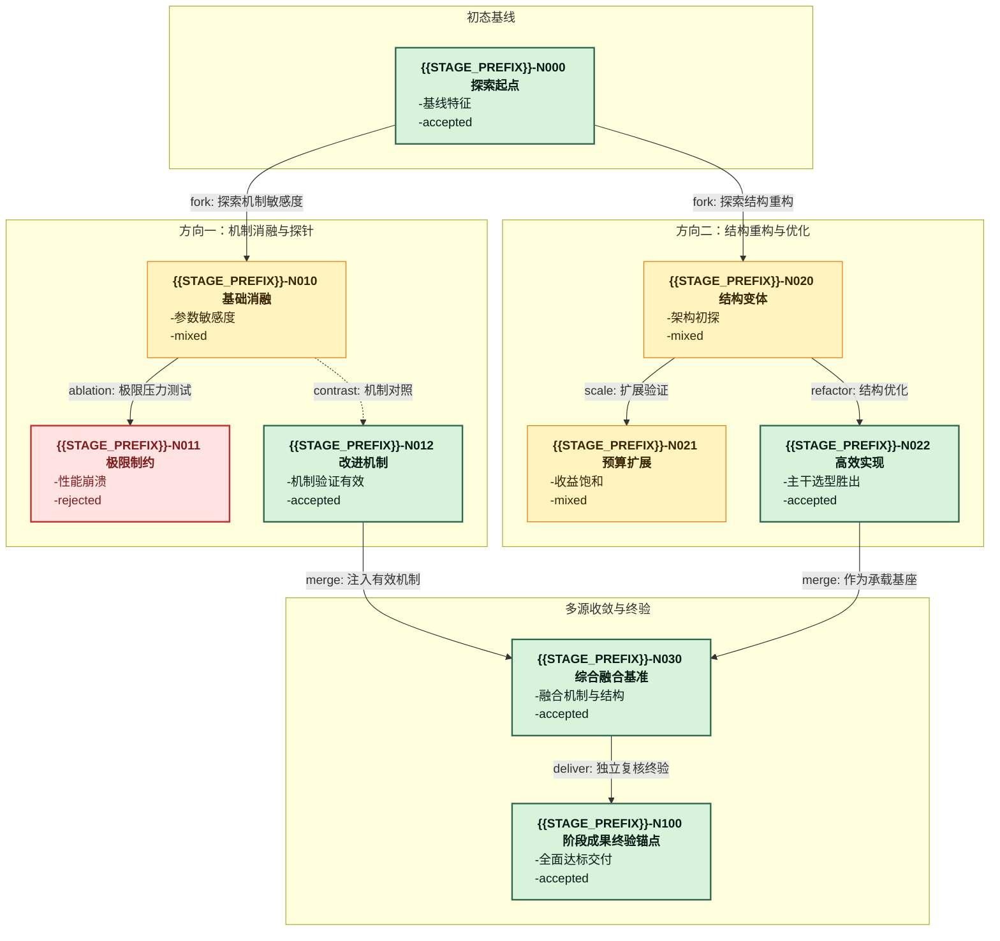

# Stages AGENTS.md

本目录是 {{PROJECT_NAME}} 的阶段性实验记录与科研语义图谱区。每个子目录代表一个有界的科研战役（stage）。

## Stage 目录结构

日常进行课题研究时，每个具体的 stage 子目录遵循以下结构组织：

```bash
<stage_name>/
├── README.md          # 该阶段课题背景、核心问题与方法思路
├── MAP.md             # 该阶段科研语义 DAG（Mermaid 图 + 节点-Run 索引表）
├── template/
│   └── run-card.md    # 该阶段专属的 run card 模板（进入新阶段时由用户与 agent 协商确定）
├── runs/              # 每次实验的事后复盘记录，按时序短编号命名（01-name.md, 02-name.md）
├── supplementary/     # 小型补充探针、跨 run 归因分析与专项诊断（可选）
├── plans/             # 阶段实验计划（可选）
├── assets/            # 图表、特征可视化与凝练化证据产物（可选）
├── scripts/           # 作图、评估或数据处理脚本（可选）
└── STAGE-REVIEW.md    # 阶段结题时的完整回顾与认知沉淀（结题时编写）
```

## Stage 生命周期与文件规范

### 1. 开启新 Stage
开启新 stage 时，agent 协助用户创建 `<stage_name>/` 目录并建立初始文件：
- **`README.md`**：记录本阶段的课题背景、拟验证的核心科学假设、基准对比点与预期验收指标。
- **`MAP.md`**：建立初始的 Mermaid 有向无环图，包含起点簇与候选方向。
- **`template/run-card.md`**：**格式与字段不设僵硬预设**，由用户与 agent 根据本阶段的具体科研形态（3D重建、实机标定、数据采集、策略训练等）共同商议定制，作为该 stage 后续所有 run 的参考基准。

### 2. 实验记录（Run Card）约定
- **文件命名**：`runs/` 内文件按时序短编号 + 语义短名命名（如 `01-baseline.md`、`02-contrast-delta.md`），简短直观且天然按时序排序。
- **YAML 属性扁平化（Obsidian Properties 规范）**：属性面板原生仅支持基本类型，**严禁使用嵌套字典对象**（嵌套会导致 Obsidian 显示 ⚠️ 警告并回退为 JSON）。多仓库记录或复合产物使用单行紧凑字符串或列表：
  ```yaml
  ---
  id: <stage-prefix>-<seq>
  date: YYYY-MM-DD
  status: planned | running | completed | failed
  commit: <full-commit-hash>
  worktree_dirty: false
  # 多仓库时使用单行文本或列表记录：code: repo_a@<hash> (dirty), repo_b@<hash>
  log_dir: <path>
  tags: []
  ---
  ```
  详细的多仓库分支对照与复杂产物清单建议下沉至正文文末的 `# Reproducibility` 表格中。训练发生在 dirty worktree 时，必须同时保存 HEAD commit 与 `worktree_dirty: true`。

### 3. 节点晋升（Node Promotion）
- **晋升标准（泛科研状态机准则）**：节点代表已实现、已观察并完成复盘的**稳定科研语义状态**（如核心科学假设得到实证或证伪、关键性能基线或验收门确立、技术路线发生重大选型转向、或产生具有长期参考价值的定论性负结果）。中间调试尝试、单纯重复验证、探索性小微调不作为节点入图。
- **打标机制**：值得入图的 run 仅需在自身 YAML 头补充标记，无需重命名文件：
  ```yaml
  node_id: N000
  qualified_id: <stage-prefix>-N000
  status: accepted | mixed | rejected | archived
  parents: []
  ```
- **依赖方向固定为 `runs → MAP`**：run 是自包含的客观事实源，删除或重构图谱决不影响实验记录本身的客观语义。节点晋升由用户判别并主动要求（自主研究授权期间 agent 可依据上述标准自行识别完成态）。

### 4. 阶段结题（`STAGE-REVIEW.md`）
阶段收尾或技术路线发生重大转移时，编写 `STAGE-REVIEW.md`，包含：
- **阶段综述**：用一段连贯凝练的 paper-flavor 文本总结本阶段已建立的事实、关键结论与交付状态；
- **路线总表**：按分支梳理假设改动、物理/评测结果与科研权衡判断；
- **核心证据链**：按事实分小节论述，直链各个支撑性的 run cards。

## MAP 拓扑与语义簇规范

每个 stage 维护一张 `MAP.md`，关注“科研语义如何从一个已验证状态演化到下一个状态”，其 Mermaid 结构参考如下规约：

### 1. 语义簇与多样化拓扑连接

参考成熟图谱实践，节点通常不孤立散落，而是按十位段编号族群聚类到具有明确物理/方法背景含义的 `subgraph` 中（例如探索起点簇、特定变量消融簇、跨拓扑迁移簇等）。拓扑连接模式应根据科研实验实际关系灵活表达，常见形态包括：

- **顺承演进**（`NodeA -->|continuation/refinement: Δ| NodeB`）：沿单一方向在参数或尺度上的纵向深入；
- **并列分叉**（`Parent -->|ablation A| Child1` 且 `Parent -->|ablation B| Child2`）：从同一基座出发，在不同维度（如算法机制 vs 算力预算）并行探索独立假设；
- **同级横向对照**（`Child1 -. "contrast: A 对照 B" .-> Child2`）：并列兄弟节点之间用**虚线**表达横向 A/B 机制对照（非实现继承）；
- **多源汇聚**（`BranchA -->|merge| NewBase` 且 `BranchB -->|merge| NewBase`）：将多个独立分支验证有效的机制融合为一个新基座；
- **跨簇跃迁**（`NodeInClusterA -->|transfer/rebuild| ClusterB`）：从簇内某个胜出节点引出下一阶段的探索簇；
- **终验/收口节点**：阶段最终成果交付锚点独立于簇外，作为阶段成果交付节点。

### 2. Mermaid 图与样式范例



> [!NOTE]
> `classDef` 样式定义必须完整放置在 `graph TD` 块内部，严禁单独拆分成无图类型的代码块，以防在 Obsidian 中引发 `UnknownDiagramError`。

### 3. 节点索引表

Mermaid 图之后紧随节点索引表，直接链接到具体的 run card：

| 节点 | 状态 | 事实与边界 |
| --- | --- | --- |
| [[runs/01-baseline|{{STAGE_PREFIX}}-N000 探索起点]] | accepted | 建立初始能力基线与任务上界 |
| [[runs/02-ablation-param|{{STAGE_PREFIX}}-N010 基础消融]] | mixed | 确认参数敏感区间，存在稳定性取舍 |
| [[runs/03-stress-test|{{STAGE_PREFIX}}-N011 极限制约]] | rejected | 极限边界下策略失效，确定物理禁区 |
| [[runs/04-mechanism-fix|{{STAGE_PREFIX}}-N012 改进机制]] | accepted | 引入自适应修正机制，成功克服瓶颈 |
| [[runs/05-arch-pilot|{{STAGE_PREFIX}}-N020 结构变体]] | mixed | 验证新表征结构可行性，吞吐略低 |
| [[runs/06-scale-budget|{{STAGE_PREFIX}}-N021 预算扩展]] | mixed | 增加计算预算边际收益递减，未突破瓶颈 |
| [[runs/07-efficient-impl|{{STAGE_PREFIX}}-N022 高效实现]] | accepted | 算法结构选型胜出，作为后续主要基座 |
| [[runs/08-merged-base|{{STAGE_PREFIX}}-N030 综合融合基准]] | accepted | 成功整合有效机制与高效结构，性能达标 |
| [[runs/09-final-acceptance|{{STAGE_PREFIX}}-N100 阶段成果终验锚点]] | accepted | 跨分布独立复核通过，完成本阶段交付 |

## 写入边界与人机权责
- Agent 不主动创建、删除、晋升图节点；可以建议候选节点，但是否记录由用户决定。
- 节点只记录已完成复盘的客观状态，不把未执行的设计设想伪装为正式节点。
- 严禁移动或删除既有实验数据、日志产物或个人笔记。
